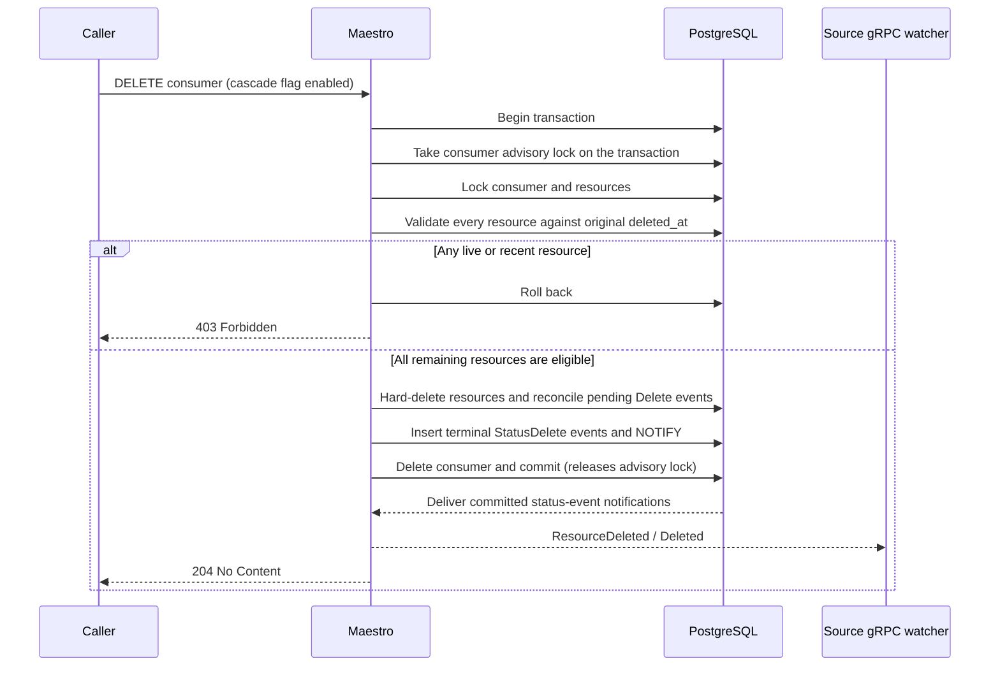

# Explicit consumer delete cascade

Related: [HYPERFLEET-1644](https://redhat.atlassian.net/browse/HYPERFLEET-1644).

## What and why

A permanently decommissioned consumer cannot acknowledge its remaining resource
deletions. Ordinary delete recovery deliberately retains those tombstones: age
alone cannot prove that an agent or its workloads are gone. This opt-in feature
allows an explicit consumer DELETE to finalize old tombstones and notify source
watchers, without direct database repair.

`--consumer-delete-cascade` is **false by default**. With the flag off, consumer
deletion retains its existing foreign-key protection, including soft-deleted
resources. There is no per-request bypass or new API field.

The flag changes the meaning of consumer DELETE for every caller of that server.
Enable it only where existing API callers are trusted to assert that a consumer
is decommissioned. Maestro does not probe the cluster or establish that the agent
is permanently absent. The caller must establish that before invoking deletion;
the age guard is an additional safety check, not proof of decommissioning.

## How it works

Each remaining resource must have `deleted_at` strictly older than the existing
`--stale-delete-event-threshold`. A live resource, a fresh deletion, or a
future-dated deletion refuses the entire operation without changes. The threshold
must be positive and fit a Go duration when cascade is enabled; startup rejects
an enabled cascade with a disabled (`0`), negative, or overflowing threshold.
This does not couple the threshold to recovery backoff settings.

The implementation uses a dedicated database transaction rather than assuming
that independent service calls participate in the HTTP middleware transaction.
Resources, pending Delete-event reconciliation, terminal status events and
consumer removal commit together. PostgreSQL holds the notifications until
commit. A failure while constructing a status, inserting an event, notifying,
deleting the consumer, or committing rolls everything back. Retrying after such a
failure is safe; retrying an already successful DELETE creates no new events.
There is no deliberately tolerated "resource gone, notification missing" gap.

Synthetic events carry `ResourceDeleted=True` with reason
`ConsumerDeletionCascade`. They preserve source, resource ID and generation,
consumer, work metadata and spec payload so the existing SDK decoder and gRPC
watch path can emit `Deleted` after the resource row has gone. A terminal event
includes a valid sequence string (`0`); source stores handle deleted conditions
before sequence ordering. It is explicitly not presented as an agent
acknowledgement.

## Concurrency and recovery state

Consumer cascades and terminal agent acknowledgements share a per-consumer
advisory lock. An acknowledgement re-reads the resource under that lock before
creating a terminal event, so an acknowledgement racing a cascade cannot emit a
second terminal event for a resource already finalized by the cascade. The
coordination is wired only when `--consumer-delete-cascade` is enabled: with the
flag off, terminal acknowledgements keep the pre-cascade behaviour and take no
per-consumer lock. All servers must use this coordination code before enabling
the flag; it cannot coordinate older binaries during a mixed-version rollout.

The advisory lock is taken on the database transaction that performs the
protected reads and writes, and is released when that transaction commits or
rolls back. The lock holder therefore runs every protected statement on the
same pooled connection that holds the lock: concurrent waiters can occupy the
remaining pool connections, but they can never starve the holder of the
connection it needs to finish and release the lock. An acknowledgement commits
its recheck, terminal event, notification and resource removal in that single
transaction, so a failure cannot leave a terminal event without the resource
removal or the reverse.

Enabling the flag also changes the acknowledgement path of every consumer,
not only the ones being decommissioned: each terminal delete acknowledgement
acquires its consumer's advisory lock, so delete acknowledgements for one
consumer serialize across all replicas for the duration of each finalization
transaction. Where acknowledgement handling is already latency-bound, this
coordination adds to that latency. **When enabling the flag, put a watch on the
advisory lock metrics**: `advisory_lock_count_total{type="consumers"}` follows
the terminal acknowledgement volume, and its `status="ERROR"` series reports
acquisition failures. Transaction-scoped consumer locks report acquisitions and
errors only — their release is the transaction commit — so they produce no
unlock counter and no hold-duration samples; the wait itself shows up as
acknowledgement latency, not as lock metrics.

Within the transaction, the consumer is locked `FOR NO KEY UPDATE` and resource
rows are locked in ID order. The weaker consumer row lock permits the recovery
scheduler's foreign-key checks while it holds resource locks, avoiding a
consumer/resource lock-order inversion. If a concurrent caller creates a new
resource, the final consumer DELETE remains protected by its foreign key and
rolls back the entire cascade rather than abandoning that new resource.

Pending resource Delete events are marked reconciled. Deleting the consumer also
removes its durable recovery queue entry via the existing cascading foreign key.
Deleted resource rows no longer carry retry state. Resources and recovery work
for other consumers are unchanged.

## Observability

`consumer_delete_cascaded_resources_total` counts resources finalized in
successfully committed cascades. It has no resource or consumer labels. Failed
transactions and retries of an already deleted consumer do not increment it.
Each committed resource finalization also produces an audit log with its resource
ID and consumer ID. The counter is process-local, not an exactly-once audit
ledger: a crash after commit but before recording the metric can undercount.

While the cascade flag is enabled, also watch the advisory lock metrics
described in _Concurrency and recovery state_: every terminal acknowledgement
acquires the consumer advisory lock, so `advisory_lock_count_total{type="consumers"}`
tracks acknowledgement coordination volume and its `status="ERROR"` series
acquisition failures.

## Trade-offs

The all-or-nothing transaction holds locks for the complete consumer cleanup.
Large consumers may require a long request and delay acknowledgements for that
consumer. This is an explicit decommissioning operation, not a periodic sweep or
a way to increase normal deletion throughput. Other consumers do not take its
advisory lock. While the flag is enabled, terminal acknowledgements for one
consumer serialize on its advisory lock across replicas; bulk decommissioning
makes that visible in acknowledgement latency.

## Alternatives

| Alternative | Why it is not used |
| --- | --- |
| Hard-delete after an elapsed timer | Age cannot distinguish a dead agent from an unreachable live agent |
| Delete all resources on consumer deletion | Could silently abandon live workloads; live and fresh rows must refuse the operation |
| Delete resources and notify in separate commits | Leaves watchers unaware if event creation fails after resource deletion |
| Keep requiring manual SQL cleanup | Does not exercise the normal status notification path and is harder to audit safely |
